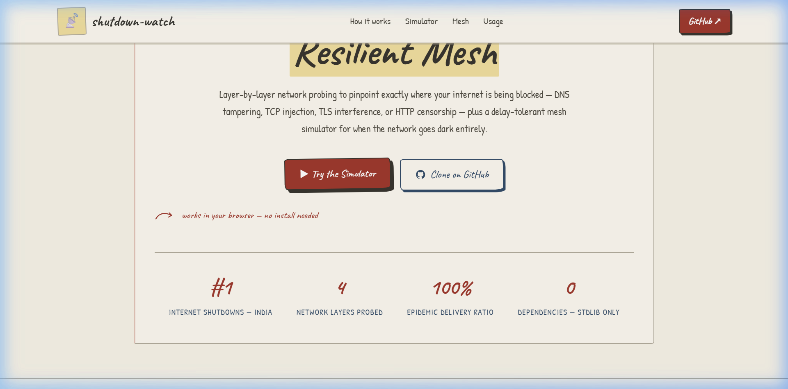
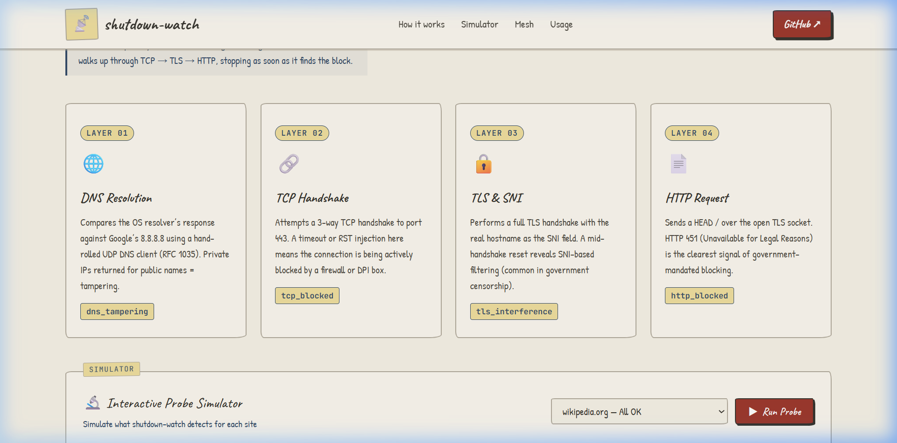
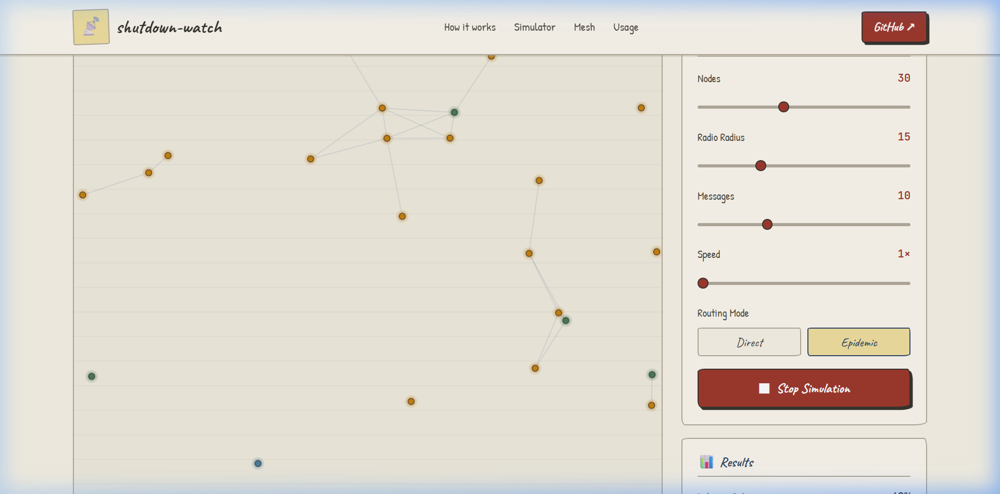

# shutdown-watch 📡

A Computer Networks research & engineering project exploring **internet shutdowns and censorship during civil protests in India**.

India has recorded more government-ordered internet shutdowns than any other country in recent years, often during civil unrest, protests, and regional tensions. This project approaches the phenomenon from a computer networking angle:
1. **Detection**: *How can we distinguish targeted service blocking from general network degradation or total blackouts?*
2. **Resilience**: *When cellular and broadband networks go dark, how can citizens continue exchanging critical messages via peer-to-peer ad-hoc meshes?*

Zero external dependencies — built entirely on the Python Standard Library and native Web standards.

---

## 🎨 Interactive Live Dashboard

Explore the research interactive web dashboard, live protocol diagnostics, and animated delay-tolerant mesh simulator:

👉 **[Launch Interactive Web Interface](https://shivamraghuvanshi2006.github.io/shutdown-watch/)** *(or open `docs/index.html` locally in any browser)*

### Interface Preview



*Hand-sketched investigation dashboard detailing the 4-layer inspection pipeline, incident timeline, and peer-to-peer transmission simulator.*

---

## 1. 🔍 Layer-by-Layer Blocking Detector (`scan`)

Probes targets sequentially across the network stack and reports the exact layer where connectivity breaks down:



| Layer | Diagnostic Probe | Failure Signature & Classification |
|---|---|---|
| **DNS** | OS resolver vs. RFC 1035 UDP client query to control resolver (`8.8.8.8:53`) | `NXDOMAIN`, bogus redirection, or RFC 1918 private IP locally -> `dns_tampering` |
| **TCP** | 3-way handshake to port 443 with configurable timeout | Handshake timeout or `RST` -> `tcp_blocked` |
| **TLS** | ClientHello with SNI matching target domain | Connection reset during handshake -> `tls_interference` |
| **HTTP** | `HEAD /` with standard HTTP headers | Status `451 Unavailable For Legal Reasons` or ISP block page -> `http_blocked` |

> **Outage Classification**: If the overwhelming majority of targets fail simultaneously at DNS or TCP, the engine classifies the incident as a `likely_outage` (indicative of full network shutdown or backhaul cut), rather than selective censorship.

### Usage
```bash
# Run scan against targets list and export results
python -m shutdownwatch scan --targets data/targets.txt --out results.json
```

---

## 2. 📱 Delay-Tolerant Mesh Simulator (`mesh`)

When telecommunication infrastructure is severed, smartphones can communicate over short-range radio (Bluetooth LE / Wi-Fi Direct) using **Store-Carry-and-Forward** delay-tolerant networking (DTN).



The built-in simulator tests node mobility and compares routing strategies:
- **Direct Delivery**: Messages are only delivered when the source physically encounters the destination.
- **Epidemic Routing**: Nodes opportunistically replicate messages to every encountering peer, flooding the network to minimize delivery time.

```bash
# Run simulation with 30 nodes and fixed random seed
python -m shutdownwatch mesh --nodes 30 --seed 1
```

### Empirical Findings
Across 30 nodes over 300 timesteps (10 messages):
- **Direct Delivery**: 50% delivery rate, high latency (~72 steps), minimal resource footprint (5 total transmissions).
- **Epidemic Routing**: 100% delivery rate, low latency (~11 steps), at the cost of ~290 transmissions.

*Trade-off takeaway: Epidemic routing guarantees resilient delivery during crises, but requires replication limits (hop limits/time-to-live) to conserve battery and radio spectrum.*

---

## 🧪 Testing

The test suite runs against synthetic sockets and mocked responses:

```bash
python -m unittest discover -s tests -v
```

All 12 test suites covering DNS serialization, classification rules, and mesh convergence pass cleanly.

---

## 🧭 Project Architecture

```
shutdown-watch/
├── data/
│   └── targets.txt              # Sample target domains
├── docs/
│   ├── index.html               # Interactive visual dashboard & mesh canvas
│   ├── REPORT.md                # Comprehensive project report & methodology
│   └── screenshots/             # Visual documentation
├── shutdownwatch/
│   ├── __init__.py
│   ├── __main__.py              # Entrypoint
│   ├── analyze.py               # Incident classification logic
│   ├── cli.py                   # Command-line interface
│   ├── dns_client.py            # Pure Python RFC 1035 DNS parser & client
│   ├── mesh_sim.py              # Delay-tolerant network simulation engine
│   └── probes.py                # Multi-layer socket & HTTP probes
├── tests/
│   └── test_shutdownwatch.py    # Unit tests
├── LICENSE                      # MIT License
└── README.md
```

---

## 🔬 Limitations & Real-world Considerations

- **Single Vantage Point**: Real censorship measurement platforms (such as OONI or Censored Planet) aggregate telemetry from distributed nodes to rule out local Wi-Fi / ISP failures.
- **Mobility Model**: The simulator employs 2D bounded random walk; actual protest and crowd dynamics follow clustered social mobility patterns.
- **Responsible Testing**: Probes only connect to lawful, publicly available domain endpoints without generating disruptive traffic.

---

## 📄 License

MIT License. See [LICENSE](LICENSE) for details.
